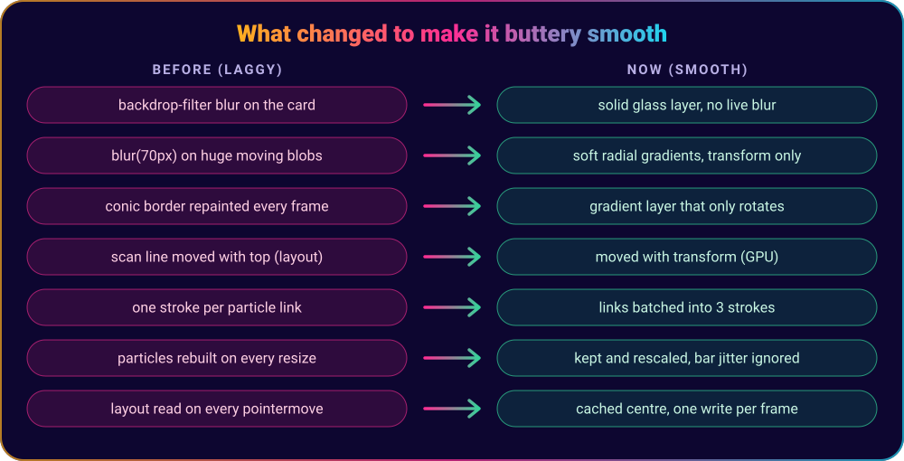

<div align="center">



<br>


</div>

<br>


## About

**Ultimate QR Code Generator** turns any text or URL into a highly scannable QR code, instantly. It runs on phone and desktop, has a fully animated glass interface that stays smooth on weak devices too, flexible quality settings and an auto-label feature so you never forget what a QR code points to.


## Key Features

<div align="center">

</div>

- **Universal input:** websites, long paragraphs, plain text. Press `Enter` to generate instantly.
- **Custom quality:** 100x100 up to 1000x1000 (low for quick sharing, high for printing).
- **Five color themes:** dark, high-contrast colors. The QR code updates live when you change color or quality.
- **PNG export:** high-quality `.png` with a white quiet zone so it scans reliably.
- **Smart auto-label:** the downloaded image prints the source URL or text under the code (very long text is shortened with `...`).
- **Share button:** on supported phones and browsers, send the finished PNG straight to any app.
- **Error correction level H:** the code still scans when it is slightly damaged or dirty.


## How It Works

<div align="center">

</div>

1. Enter your URL or text.
2. Choose the quality and the QR color.
3. Tap **Generate**.
4. Tap **Download** (or **Share** where supported).


## Butter-Smooth Performance

The interface was rebuilt so animations run on the GPU instead of repainting the page every frame.

<div align="center">

</div>

**More smoothness work**

- **Only `transform` and `opacity` animate forever.** Those two properties are handled by the GPU compositor, so the main thread stays free for typing and tapping.
- **Delta-time motion.** Particles and the 3D tilt move by elapsed time, so they feel the same on 60 Hz, 90 Hz and 120 Hz screens.
- **Adaptive quality tiers.** The app rates the device at start:

  | Tier | Device | What you get |
  | ---- | ------ | ------------ |
  | 2 | Powerful desktop | Full particle network, all effects |
  | 1 | Phones and mid devices | Lighter particle network, all card effects |
  | 0 | Weak devices, Data Saver | Same look, continuous extras switched off |

- **Frame-rate guard.** If frames are dropped on any device, it steps down one tier automatically. It never steps up again, so it cannot flicker.
- **Hover only where hover exists.** No sticky hover states on touch screens.
- **Pauses when hidden.** Animations and the particle loop stop while the tab is in the background (saves battery).
- **Non-blocking export.** PNG download and share use `toBlob`, not a giant data-URL string.
- **`prefers-reduced-motion` respected.** Users who turn animations off get a calm version.


## Design and Animation

- Animated aurora background with drifting glow blobs and a moving perspective grid.
- Interactive particle network that reacts to your cursor or finger, with a burst when a QR code is generated.
- Glass card with a rotating gradient border, 3D tilt (mouse or touch drag), floating motion and a light sheen.
- Letter-by-letter animated gradient title and a typewriter placeholder.
- Glowing input focus with an animated underline and a clear button.
- Flowing gradient **Generate** button, ripple on every button, scan-line and pulsing corner brackets when the QR appears.
- Toast notifications instead of browser alerts, and a shake on invalid input.
- Fully responsive from small phones to large desktops, safe-area aware for notched phones.


## Tech Stack

- HTML5 and CSS3 (gradients, keyframes, `transform`/`opacity` animation, `mask-image`)
- Vanilla JavaScript (Canvas API for particles and PNG export, `requestAnimationFrame`, `toBlob`)
- [qrcodejs](https://www.npmjs.com/package/qrcodejs) loaded from the jsDelivr CDN (internet needed on first load)
- Animated SVG for the logo, favicon and this README

## Project Structure

```
index.html        page markup
qrcode.css        styles and GPU-friendly animations
qrcode.js         QR logic, tilt, particles, performance tiers, toasts
assets/
  logo.svg        logo and favicon
  banner.svg      animated README banner
  typing.svg      animated typing line
  divider.svg     animated section divider
  features.svg    animated feature cards
  flow.svg        animated how-it-works diagram
  smooth.svg      before / now performance diagram
README.md         this file
```

## Run Locally

No build step. Open `index.html` in any modern browser, or host the folder on GitHub Pages.

## Browser Support

Latest Chrome, Edge, Safari and Firefox on phone and desktop.


<div align="center">


**Created by Anubhab Dutta**

</div>
